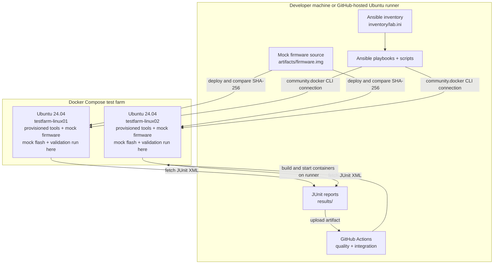

# Architecture

This proof of concept uses Ansible to provision and validate two Ubuntu Docker containers as a small simulated automotive test farm.

## Execution flow

1. Docker Compose starts two Ubuntu containers on the machine running the workflow.
2. Ansible uses `community.docker.docker` to run tasks through the Docker CLI inside each named container.
3. `provision.yml` installs common packages and creates `/opt/test-farm`.
4. `deploy_artifact.yml` copies the mock image and compares the deployed image checksum against the controller-side source file.
5. `mock_flash.yml` invokes `mock_flash.py`. The script reads the image, verifies the supplied SHA-256, and writes a JSON result; it does not access hardware.
6. `validate_test_farm.yml` invokes `validate_test_farm.py` on each host. The validator checks workspace, ADB availability, firmware integrity, flash report contents, and free disk space, then writes JUnit XML for collection by CI.

The GitHub Actions quality job runs Ansible syntax checks, lint, Python compilation, and unit tests. The integration job builds and starts its own containers on the GitHub-hosted Ubuntu runner, then provisions, checks idempotency, deploys, simulates flashing, and validates each host. It then corrupts Linux01's temporary firmware copy, verifies the checksum failure and preserved JUnit reports, redeploys the trusted artifact to both hosts, and uploads the reports.

## Scope and limits

- The firmware is harmless mock data, and flash results are simulations.
- No physical devices, real firmware flashing, or production infrastructure are involved.
- Rolling maintenance is serial and fail-fast with health checks. Package updates are disabled by default; rollback is not implemented.
- The full Docker integration must run on a Docker-capable runner to verify end-to-end behavior.
